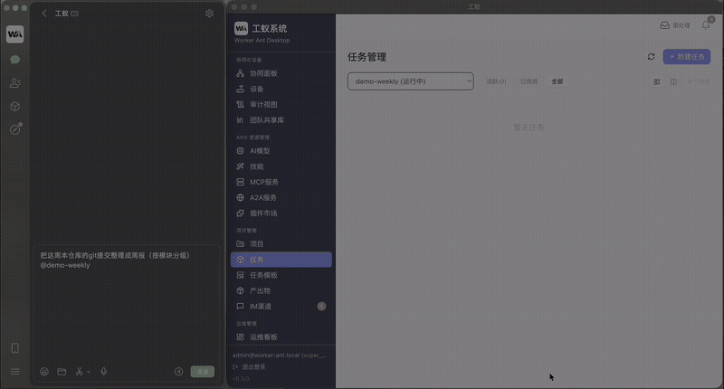

#  Worker Ant

> **A self-hosted AI agent crew you command from your phone.**



<sub>38-second recording (silent): a WeChat message → local execution → report and receipt.</sub>

Describe a task in plain language. It **actually** edits files, runs commands, and commits to git — **on your own machine**.
Deliverables are registered as first-class artifacts. And when you're away from your desk, one message on WeChat / DingTalk / Feishu gets you progress, approvals, and results.

**Execution stays on your machine. Your tasks never sleep.**

[中文](README.md) · [Contributing](CONTRIBUTING.md) · [License](#license)

---

## Why Worker Ant

| The problem                                                  | How most tools do it           | How Worker Ant does it                                                                                      |
| ------------------------------------------------------------ | ------------------------------ | ----------------------------------------------------------------------------------------------------------- |
| You need real work done, but your code can't go to the cloud | Cloud agents upload your repos | **Executes locally** — files and commands never pass through our servers; model endpoint is yours to choose |
| You want to check on a task while away                       | Only from your desk            | **Command it from IM**: WeChat / DingTalk / Feishu / WeCom / QQ                                             |
| Finished work is buried in chat logs                         | Output is a wall of text       | **Deliverables as first-class artifacts** — registered, rated, traceable                                    |
| You can't tell what the agent actually did                   | Black box                      | **Event sourcing** — every action auditable and replayable                                                  |

---

## Core capabilities

- **64 tools across 8 categories**: shell, file I/O, git, memory, search, MCP, subagents, device control…
- **Multi-agent**: automatic task decomposition; subagents (deploy / explorer / builder / verifier), debate, and swarm modes
- **Positions (roles)**: a position library with built-ins; tasks can be assigned to a position; transferable lessons
  settle back into that position, and mature ones can be promoted into rules / skills / knowledge — or revoked.
  A position profile shows what it has accumulated (Pro can export / import position knowledge packs)
- **Project business knowledge**: project profiles form automatically (bootstrapped during the nightly absorption,
  switchable off); candidate domain packs are ranked by similarity with previews; multiple packs are injected in
  order of relevance to the current task
- **Memory & knowledge graph**: episodic / semantic / procedural / retrospective memory; the team library lets you
  preview shared items, and deleted (tombstoned) entries never enter the candidate list
- **IM-native**: WeChat / QQ / DingTalk / WeCom / Feishu — send a message to assign, track, approve, and receive;
  first contact greets you and offers help, ambiguous names are clarified before acting, and a position can be claimed
- **IM approval console** (Team): approve devices and answer cross-machine questions from a private chat; high-risk actions never reach your phone
- **Multi-machine collaboration** (Team): dispatch criteria are decided per task (only work that truly needs your local
  directory / attachments stays local) and offline peers are skipped; peers are scored against each task's required
  capabilities; remote progress is visible and failed parents cascade a stop to children
- **Generic AI terminal access** (Team): discover and negotiate standard A2A agent cards, intent first with invoke fallback
- **Multi-account device clouds**: multiple Tuya accounts + Home Assistant, with desired / actual / unknown read-back states
- **Bring your own model**: BYO key, point it at any OpenAI-compatible endpoint or your own gateway; the model page
  uses two rulers (usable / what it is missing)
- **Event-sourced engine**: pause / resume / replay, rateable deliverables, full audit trail; the outbound call log
  carries timestamps and probe markers

---

## Quick start

### Option 1: Installer (macOS / Windows / Linux)

Download the installer for your platform from [GitHub Releases v0.6.0](https://github.com/Reamy/worker-ant/releases/tag/v0.6.0); SHA-256 checksums are on the Release page:

- **macOS 13+ (Apple Silicon)**: `worker-ant-0.6.0-mac-arm64.dmg` (or `.zip`). Developer ID signed and Apple-notarized, so it opens without right-click workarounds.
- **Windows 10/11 (x64)**: `worker-ant-0.6.0-win-x64.exe`. **Not code-signed**; SmartScreen may warn about an unknown publisher — choose "More info → Run anyway".
- **Linux (x86_64)**: `worker-ant-0.6.0-linux-x86_64.AppImage` or `.deb`. **Not signed**; `chmod +x` the AppImage first.

**The v0.2.0 installer crashes on first launch — do not use it.** v0.6.0 adds positions (roles) with position knowledge (lessons can be promoted or revoked; Pro can export / import position knowledge packs), project business knowledge (auto-formed profiles, similarity-ranked candidates, relevance-ordered injection), previewable team library items, per-task cross-machine dispatch, ambiguity clarification and position claiming in IM, and a readable outbound call log — plus more reliable abort and a lighter finalize. Auto-update is not enabled yet, so users on older builds should download and reinstall manually.

- Requirements: **macOS 13+ / Apple Silicon (arm64)**, **Windows 10/11 (x64)**, or **Linux (x86_64)**. No Intel Mac build yet.
- On first launch a **setup wizard** walks you through adding a model API key (or pointing at your own gateway) → verifying the ANS connection → creating a project → describing a task.

### Option 2: Run from source

```bash
# Requirements: Node.js >= 22, pnpm >= 9
pnpm install

# Terminal 1 — start the AI resource center (ANS)
pnpm dev:ans

# Terminal 2 — start the desktop app (run in macOS Terminal.app, not an IDE terminal)
#   ⚠ Terminal 1 must be started first: run.sh rebuilds the shared native module
#     better-sqlite3 for the Electron ABI, while ANS needs the Node ABI — the two
#     are mutually exclusive. See "About ANS".
cd apps/worker-ant-desktop && bash run.sh
```

On first launch a **setup wizard** walks you through adding a model API key (or pointing at your own gateway) → verifying the ANS connection → creating a project → describing a task in one sentence.

### About ANS (AI Resource Center)

The desktop app needs ANS to route models. **When running from source, start ANS first in a separate terminal: `pnpm dev:ans`** (it starts ANS with the Node ABI).

The desktop app has an on-demand auto-start, but **it does not work in source mode**: `run.sh` / `desktop:dev` rebuild the **shared** native module `better-sqlite3` for the **Electron ABI**, while ANS needs the **Node ABI** — the two are mutually exclusive, so auto-start **fails honestly and tells you to run `pnpm dev:ans` first** rather than hanging silently (a packaged build ships no ANS entry point and likewise falls back). Default port `27183`, overridable with `ANS_SERVER_PORT`. All desktop→ANS calls are **HMAC-signed outbound**.

---

## Three real use cases

1. **Weekly report automation** — "Summarize this repo's git commits from the past week into a report, grouped by module."
2. **Repo health check** — "Scan the whole repo for TODO/FIXME, group by file, and draft GitHub issues."
3. **Service watchdog** — "Check these services every 30 minutes and alert me on WeChat if anything is down."

(The template library ships more ready-to-run examples.)

---

## Architecture

```
┌──────────────────────────────────────────────┐
│  Desktop (Electron)                          │
│  ┌────────────┐   IPC   ┌──────────────────┐ │
│  │  renderer  │◀────────▶│  main process     │ │
│  │  (React)   │          │  · task engine    │ │
│  └────────────┘          │  · agent loop     │ │
│                          │  · memory / KG    │ │
│                          │  · IM adapters    │ │
│                          │  · deliverables   │ │
│                          └────────┬─────────┘ │
└───────────────────────────────────┼───────────┘
                                    │ signed (HMAC)
                          ┌─────────▼─────────┐
                          │  ANS :27183        │
                          │  model match / gw  │
                          └─────────┬─────────┘
                                    │
                          ┌─────────▼─────────┐
                          │  Your model        │
                          │  (OpenAI-compat)   │
                          └───────────────────┘
```

> The current main form is the **Electron desktop app: the whole engine runs inside the main process**. `apps/_archive/` holds a historical (pre-2026-08) web/server form and is excluded from build and release.

---

## Editions & pricing

| Edition                      | Price                                       | What you get                                                                                                                                                                  |
| ---------------------------- | ------------------------------------------- | ----------------------------------------------------------------------------------------------------------------------------------------------------------------------------- |
| **Community** (this repo)    | Free                                        | Full engine (3 concurrent · 1 project · 1 collaboration node), BYO key                                                                                                        |
| **Pro**                      | ¥99/mo · ¥899/yr                            | 8 concurrent, unlimited projects, 1 collaboration node; project knowledge export/import, **position knowledge export/import**, image & video understanding, long documents, domain packs, priority support |
| **Early bird lifetime**      | ¥1999 (first 100)                           | One-time purchase of Pro capabilities, forever                                                                                                                                |
| **Team (package)**           | ¥599/mo · ¥5990/yr (per package, ≤20 nodes) | 20 local accounts, up to 20 collaboration nodes; device discovery & control, AI terminal intent access, audit view & CSV export, shared team library, project-profile sharing |
| **Enterprise (self-hosted)** | Custom (planned — not yet available)        | Air-gapped deploy + SLA                                                                                                                                                       |

> **Buy**: [Mianbaoduo shop](https://mbd.pub/o/author-bW2ZlHFtZg==/work) — Pro monthly / annual / early-bird lifetime; Team package monthly / annual. Enterprise is not on sale yet. Team packages are provisioned manually (collect up to 20 machine fingerprints, then issue; every Team license carries an expiry date). The macOS app is now **Developer ID signed** (Team XRZNWLDU86) **and notarized** by Apple (notarytool `Accepted`, ticket stapled; the app inside the DMG and ZIP reports `accepted / Notarized Developer ID` to `spctl`). **It is now published**: [download v0.6.0](https://github.com/Reamy/worker-ant/releases/tag/v0.6.0) — macOS, Windows, and Linux installers are on that Release, with SHA-256 checksums listed there. The Windows and Linux builds are unsigned, so the OS may warn on first launch; no Intel Mac build yet. A 14-day Team-tier trial ships with the desktop app.
>
> Every capability above **is available in the desktop app today** (the tier gates ship in this repo and can be verified). Each edition also has seven-dimension capacity caps (registered devices / external terminals / A2A servers / knowledge cards per project / shared team memories / IM channels / task templates): Community 5 / 1 / 1 / 8 / 200 / 2 / 5, Pro 30 / 3 / 3 / 24 / 2000 / 5 / 30, Team 200 / 20 / 10 / 60 / unlimited / unlimited / unlimited — **new additions only; existing records are never removed**. The cloud collaboration service is not released yet and this table will be updated when it is — no unreleased capability is advertised as a selling point. **This repository (desktop + engine) stays open source.** Prices are in CNY (¥).

---

## Community & contributing

- Issues & ideas: GitHub Issues
- Chat: Discord (coming soon)
- Guide: [CONTRIBUTING.md](CONTRIBUTING.md)

---

## License

[AGPL-3.0](LICENSE). Commercial multi-tenant use requires a separate commercial license — see [`COMMERCIAL_LICENSE.md`](COMMERCIAL_LICENSE.md).

---

<sub>Worker Ant System</sub>
