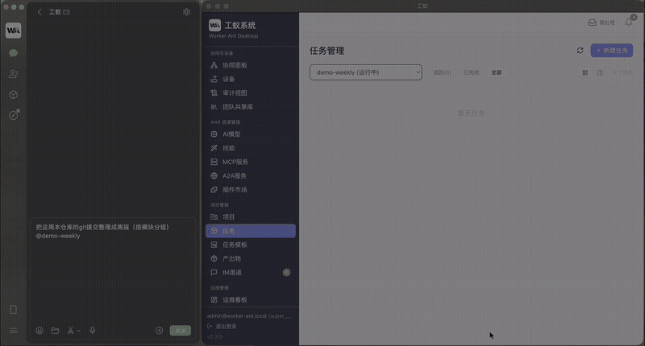

#  工蚁 Worker Ant

> **跑在你自己机器上、用手机就能指挥的私有 AI 打工队。**



<sub>38 秒实录（无声）：微信发消息 → 本机执行 → 周报与回执。</sub>

你用自然语言派活，它**真的**在你的电脑上改文件、跑命令、提交 git；
产出物登记成可交付资产；你出门在外，用微信/钉钉/飞书发条消息就能查进度、审产物。

**执行在你机器上，任务不睡觉。**

[English](README.en.md) · [贡献指南](CONTRIBUTING.md) · [许可](#许可)

---

## 为什么是工蚁

| 你遇到的                       | 常见工具的规则                 | 工蚁的做法                                           |
| ------------------------------ | ------------------------------ | ---------------------------------------------------- |
| 想让 AI 干真活，但代码不能上云 | 云 Agent 要求把代码/数据传上去 | **本机执行**——代码不经过我们的服务器，模型端点由你选 |
| 出门在外想盯任务               | 只能回电脑前看                 | **手机 IM 远程指挥**：微信 / 钉钉 / 飞书 / 企微 / QQ |
| 干完的活散在聊天记录里         | 输出是一段文字                 | **成果一等公民**——文件登记、评级、可回溯             |
| 想知道 AI 到底做了什么         | 黑盒                           | **事件溯源**——每一步可审计、可重放                   |

---

## 核心能力

- **64 个工具 / 8 大类**：shell 执行、文件读写、git、记忆、搜索、MCP、子代理、设备控制……
- **多智能体**：任务自动拆解为子任务；子代理（部署 / 探索 / 构建 / 验证）、辩论、蜂群三种模式
- **岗位（角色）**：岗位库与内置岗位、任务按岗位派活；干过的活把可迁移的教训沉淀回岗位，
  够格的晋升成规范 / 技能 / 知识并可撤回；岗位画像一页看清在积累什么（Pro 可导出 / 导入岗位知识包）
- **项目业务知识**：项目画像自动成型（夜间增量吸收时 bootstrap，设置页可关）；候选领域包按相似度推荐并预览；
  多包注入按与当前任务的相关性排序
- **记忆与知识图谱**：情景 / 语义 / 程序 / 反省四类记忆；团队共享库可预览内容，已删除的空记忆不进候选
- **IM 原生**：微信 / QQ / 钉钉 / 企微 / 飞书——发消息 = 派活 / 查进度 / 审批 / 收成果；
  首次接入有欢迎与帮助，人名 / 项目名有歧义先问一句，能认「这件事归哪个岗位」
- **IM 授权台**（Team）：私聊里审批设备、回答跨机提问；高危操作永不进手机
- **多机协同**（Team）：派活判据下沉到任务级（真需要本机目录 / 附件才留本机）、设备不在线不派；
  按任务所需能力给节点打分、能力优先派活；跨机进度可见，父任务失败自动收口
- **通用 AI 终端接入**（Team）：发现并协商标准 A2A agent card，意图优先、指令兜底
- **设备云多账号**：涂鸦多账号 + Home Assistant，控制回读三态（期望 / 实际 / 未知）
- **自带模型**：BYO Key，接入你自己的 OpenAI 兼容端点或自建网关；模型页两把尺（可用性 / 缺什么能力）
- **事件溯源引擎**：任务可暂停 / 恢复 / 重放，成果可评级，全链路可审计；外部调用账带时间与探针标记

---

## 快速开始

### 方式一：安装包（macOS / Windows / Linux）

从 [GitHub Releases v0.6.0](https://github.com/Reamy/worker-ant/releases/tag/v0.6.0) 下载对应平台的安装包，校验值（SHA-256）见 Release 页面：

- **macOS 13+（Apple Silicon）**：`worker-ant-0.6.0-mac-arm64.dmg`（或 `.zip`），已完成 Developer ID 签名与 Apple 公证，双击挂载、把「工蚁」拖进「应用程序」即可。
- **Windows 10/11（x64）**：`worker-ant-0.6.0-win-x64.exe`，**未做代码签名**；SmartScreen 可能提示「未知发布者」，点「更多信息 → 仍要运行」即可。
- **Linux（x86_64）**：`worker-ant-0.6.0-linux-x86_64.AppImage` 或 `.deb`，**未签名**；AppImage 需先 `chmod +x`。

**v0.2.0 安装包存在首次启动即崩的缺陷，请勿再使用。** v0.6.0 新增**岗位（角色）与岗位知识**（经验可晋升 / 可撤回，Pro 岗位知识包导出导入）、**项目业务知识**（画像自动成型、候选按相似度推荐、注入按相关性排序）、团队共享库可预览、任务级跨机真派、IM 歧义澄清与岗位认领、外部调用账可读，并让任务中止与收尾更稳更轻。自动更新尚未启用，已装旧版的用户请手动下载覆盖安装。

- 系统要求：**macOS 13+ / Apple Silicon（arm64）**、**Windows 10/11（x64）**、**Linux（x86_64）**。Intel Mac 版本暂未提供。
- 首次启动会进入**安装向导**：填模型 API Key（或指向自建网关）→ 自检 ANS 连接 → 建一个项目 → 用一句话描述任务。

### 方式二：从源码运行

```bash
# 环境要求：Node.js ≥ 22、pnpm ≥ 9
pnpm install

# 可选——创建本地配置文件（含端口/API 键等；不建则用 dev 缺省值启动）
cp .env.example .env

# 终端 1 — 启动 AI 资源中心（ANS）
pnpm dev:ans

# 终端 2 — 启动桌面端（请在 macOS 的 Terminal.app 里运行，勿用 IDE 终端）
#   ⚠ 必须先起终端 1：run.sh 会把共享的原生模块 better-sqlite3 重编为 Electron ABI，
#     而 ANS 需要 Node ABI，两条 ABI 互斥 —— 详见「关于 ANS」
cd apps/worker-ant-desktop && bash run.sh
```

首次启动会进入**安装向导**：跟着填模型 API Key（或指向自建网关）→ 自检 ANS 连接 → 建一个项目 → 用一句话描述任务，看它干活。

### 关于 ANS（AI 资源中心）

桌面端需要 ANS 才能调度模型。**从源码运行时，请先在另一个终端起 ANS：`pnpm dev:ans`**（它以 Node ABI 起 ANS）。

桌面端虽内置"按需代起"，但**源码态下它不成立**：`run.sh` / `desktop:dev` 会把**共享的**原生模块 `better-sqlite3` 重编成 **Electron ABI**，而 ANS 需要 **Node ABI**——两条 ABI 互斥，代起会**如实失败并提示你先跑 `pnpm dev:ans`**，不会静默卡住。（打包版不同：ANS 运行时随包在 `Resources/ans-server/`，桌面以 `ELECTRON_RUN_AS_NODE=1` 代起，全包只有一个 better-sqlite3、无 ABI 冲突。）端口默认 `27183`，可用 `ANS_SERVER_PORT` 覆盖。桌面对 ANS 的调用一律**出站 HMAC 签名**。

---

## 三个真实用例

1. **周报自动化** —— "把这周本仓库的 git 提交整理成一份周报，按模块分组"
2. **仓库体检** —— "扫描全仓 TODO/FIXME，按文件聚合并生成 issue 草稿"
3. **值守告警** —— "每 30 分钟巡检这几个服务，异常时微信告警给我"

（模板库里还有更多开箱即用的示例。）

---

## 架构

```
┌──────────────────────────────────────────────┐
│  桌面端 (Electron)                            │
│  ┌────────────┐   IPC   ┌──────────────────┐ │
│  │  renderer  │◀────────▶│  main 主进程      │ │
│  │  (React)   │          │  · 任务引擎/调度   │ │
│  └────────────┘          │  · Agent 执行循环  │ │
│                          │  · 记忆/知识图谱   │ │
│                          │  · IM 适配器       │ │
│                          │  · 成果交付        │ │
│                          └────────┬─────────┘ │
└───────────────────────────────────┼───────────┘
                                    │ 出站签名(HMAC)
                          ┌─────────▼─────────┐
                          │ ANS 资源中心 :27183│
                          │ 模型匹配/网关/计费  │
                          └─────────┬─────────┘
                                    │
                          ┌─────────▼─────────┐
                          │  你的模型端点      │
                          │  (OpenAI 兼容)     │
                          └───────────────────┘
```

> 当前主形态是 **Electron 桌面端：整个引擎运行在 main 进程内**。仓库内 `apps/_archive/` 是历史归档（旧 Web/Server 形态），不参与构建与发布。

---

## 版本与定价

| 版本                    | 价格                                 | 说明                                                                                                              |
| ----------------------- | ------------------------------------ | ----------------------------------------------------------------------------------------------------------------- |
| **Community**（本仓库） | 免费                                 | 核心引擎全功能（并发 3 · 1 个项目 · 协同节点 1 台），BYO Key                                                      |
| **Pro**                 | ¥99/月 · ¥899/年                     | 并发 8、不限项目、协同节点 1 台；项目知识包导出/导入、**岗位知识包导出/导入**、图片与视频理解、长文档、领域包、产出物批量导出（CSV）、优先支持 |
| **早鸟终身**            | ¥1999（前 100 名）                   | 一次性买断 Pro 终身能力                                                                                           |
| **Team（团队授权包）**  | ¥599/月 · ¥5990/年（每包，≤20 节点） | 20 个本机账号、最多 20 台协同节点；设备发现与控制、AI 终端意图接入、审计视图与 CSV 导出、团队共享库、项目画像共享 |
| **企业私有化**          | 定制（规划中，暂不提供）             | 内网部署 + SLA                                                                                                    |

> **购买**：[面包多店铺](https://mbd.pub/o/author-bW2ZlHFtZg==/work)——Pro 月付 / 年付 / 早鸟终身；团队授权包月付 / 年付。企业版暂不售卖。团队包为人工开通（收齐 ≤20 台机器指纹后签发，须带到期日）。macOS 安装包已完成 **Developer ID 签名**（Team XRZNWLDU86）**并经 Apple 公证**（notarytool `Accepted`，票据已装订；包内应用 `spctl` 为 `accepted / Notarized Developer ID`）。**已发布**：[下载 v0.6.0](https://github.com/Reamy/worker-ant/releases/tag/v0.6.0)——macOS、Windows、Linux 三个平台的安装包均在该 Release，校验值（SHA-256）见页面。Windows 与 Linux 版未做代码签名，首次运行可能被系统提示；Intel Mac 版本暂未提供。桌面端自带 14 天团队版试用。
>
> 上表的能力**当前都在桌面端可兑现**（档位闸与引擎同仓，可自行核对）。各档另有八维容量上限（设备登记 / 外部终端 / A2A 服务 / 每项目知识卡 / 团队共享记忆 / IM 渠道 / 任务模板 / 设备云账号）：社区 5 / 1 / 1 / 8 / 200 / 2 / 5 / 0（需专业版）、Pro 30 / 3 / 3 / 24 / 2000 / 5 / 30 / 2、Team 200 / 20 / 10 / 60 / 不限 / 不限 / 不限 / 不限——**只拦新增，已有记录不受影响**。云端协作服务尚未发布，发布时会在本表更新——不以未交付的能力作卖点。**本仓库（桌面端 + 引擎）始终开源**。

---

## 社区与贡献

- 问题与建议：GitHub Issues
- 交流：Discord（筹备中）
- 贡献指南：[CONTRIBUTING.md](CONTRIBUTING.md)

---

## 许可

[AGPL-3.0](LICENSE)。商业多租户使用需另行获得商业许可，见 [`COMMERCIAL_LICENSE.md`](COMMERCIAL_LICENSE.md)。

---

<sub>工蚁系统 · Worker Ant System</sub>
